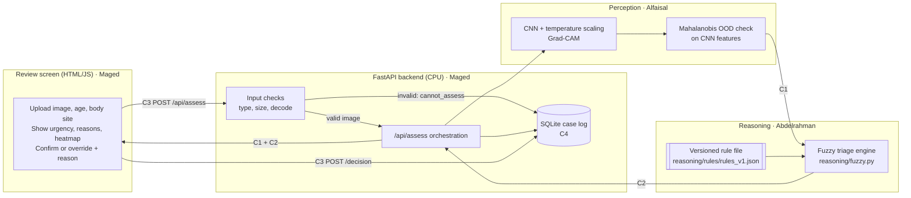
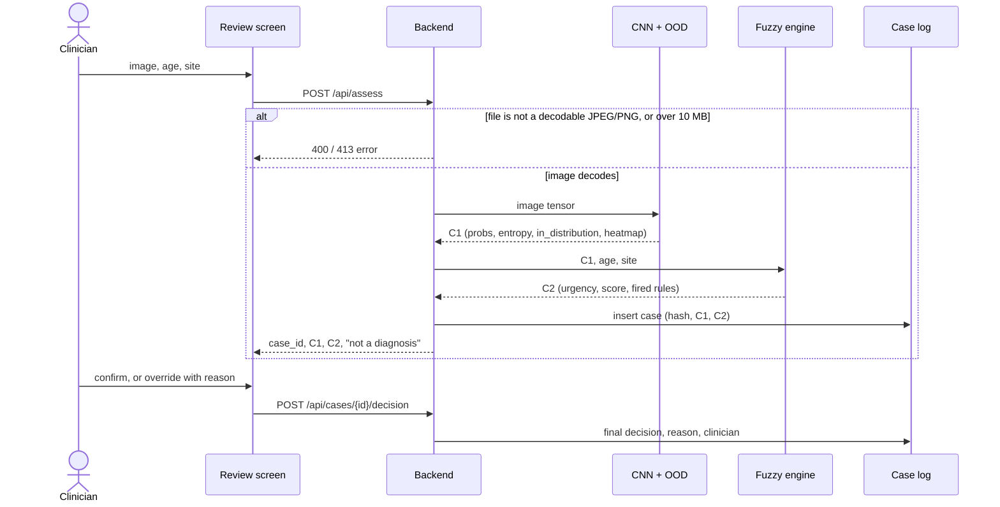
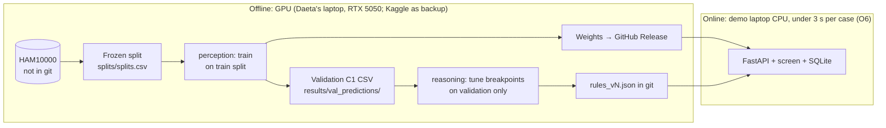

# Architecture sketch v1 (DERM-11)

Owner: Abdelrahman. For agreement at the W2 meeting together with `docs/contracts.md`.
The final diagrams for the design report (DERM-20) are drawn from this sketch.

DermaScan is a perception → reasoning → action pipeline (proposal §3). Three parts are built
in parallel against the contracts and joined at the proof of concept (DERM-17, W3).

## 1. Components and owners

| Component | Responsibility | Code | Contract out |
|---|---|---|---|
| Review screen | Collect inputs, show the recommendation and reasons, record the decision | `app/static/` | C3 requests |
| Backend | Validate, orchestrate, log; never stores the image | `app/` | C3 responses, C4 rows |
| Perception | Class probabilities, uncertainty, OOD flag, heatmap | `perception/` | C1 |
| Reasoning | Urgency, score and fired rules from C1 + context | `reasoning/` | C2 |
| Case log | Audit trail of every recommendation and decision | SQLite file | C4 |

## 2. One assessment, step by step

If the OOD check fails, the fuzzy engine's gate G1 returns `cannot_assess`. The case is still logged,
and the clinician still records a decision, with a reason (O3).

## 3. Offline (training and tuning) vs online (demo)

The test split is never used for training or tuning. It is read once, in W8 (DERM-32 and DERM-33),
after the model and rules freezes (Ground rules 2 and 12).

## 4. Design decisions recorded so far

| Decision | Why | Alternative rejected |
|---|---|---|
| Fuzzy layer after the CNN, not before | Turns uncertain perception into a readable, editable triage decision (proposal §4 gap) | Learned meta-classifier: clinicians cannot read or edit it |
| Floor rules for safety ("at least routine") | Centroid averaging cannot lower a safety rule's effect; context can only raise urgency | All-Mamdani rules: adding a weak "urgent" rule can lower the score |
| Rules in a versioned JSON file with a source per rule | Provenance for every rule (brief; proposal §3); `rules_version` in every log row | Rules hard-coded in Python |
| OOD check before reasoning, separate from entropy | Entropy alone does not catch a non-skin photo (proposal §3) | Entropy threshold only |
| Image hashed, never stored | Privacy (proposal §6) | Storing uploads for later review |
| CPU inference, GPU training | Demo runs on a laptop; training needs a GPU | GPU at demo time |

## 5. Open points for W2

1. Agree the C1–C4 changes listed at the end of `docs/contracts.md`.
2. Where the OOD threshold lives: in the model release (with the weights) or in a config file in the repo.
3. Whether `/api/assess` calls the CNN in-process (simplest; current sketch) or as a separate worker.
